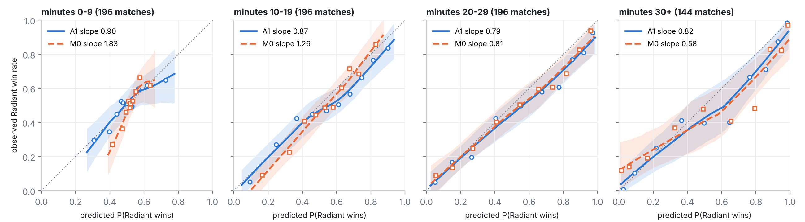

# Live Dota 2 win probability: report

## Summary

- **Goal:** a probability that Radiant wins, updated every minute, using only what is known at that minute.
- **Baseline (M0):** logistic regression on the gold lead.
- **My model (A1):** logistic regression with a strong L2 penalty on 10 in-game features and a time term.
- **Same game version (96 later matches):** A1 beats M0. Log loss 0.598 against 0.633, gain +0.035 [+0.001, +0.077]. Most of the gain is after minute 30.
- **Next game version (100 matches):** the two models cannot be told apart.
- **Before minute 30** (both test sets pooled): neither model clearly wins.
- **Why A1 helps:** it trusts the gold lead less as the game goes on, so it is less overconfident late in the game.
- **Decision:** ship A1, with the limits in section 3. All numbers come from the notebook (about 15 minutes from scratch).

## 1. Data, rows and validation scheme

**Data**

- 500 usable professional matches from OpenDota: 400 just before the game update from 7.40 to 7.41 (24 March 2026), 100 just after.
- No gap in the window; one match was skipped as shorter than 10 minutes.
- The update is inside the window because a live model must survive the next update.
- The 500 match ids are pinned by a SHA-256, so a rerun pulls the same matches.

**Rows**

- One row per match and minute, t = 0 to L − 2 (L = length of `radiant_gold_adv`): 17,577 rows.
- The last array element is dropped: it can fall at or after the end of the match.
- A row uses array values up to index t and events up to 60·t seconds. End-of-match fields are never read.

**Leakage checks (all pass)**

- Every row equals its recompute from the match cut at minute t.
- Every row stays the same when everything after minute t is replaced by random values.
- A planted bug that reads index t + 1 is caught, so the check really works.

**Split**

- The model will be used on future matches, so the split follows time.
- `train_tune`: first 304 matches of 7.40. `test_old`: next 96 matches of 7.40. `test_new`: 100 matches of 7.41.
- `test_old` asks: does the model hold on later matches? `test_new` asks: does it survive a game update?
- The cut was fixed by a rule before any label was read: no series (best-of-N between the same teams) on both sides.
- All fitting and tuning used `train_tune` only: 5 contiguous time blocks, series kept whole, each block scored by a model fitted on the other four (out-of-fold, OOF).
- All rows of a match share one label, so the real sample is about 100 matches per test set. Every interval resamples whole matches (2,000 draws; 1,000 for calibration), and gains are paired.

## 2. Model and key choices

**Why logistic regression**

- In my view, 304 training matches are too few for a complex model. It would overfit, learning the noise of these matches.
- So I kept a simple model and controlled it with a strong penalty.
- The data agree: out of fold, trees, boosting, splines and phase interactions did not beat it.

**The two models**

| | M0 (baseline) | A1 (model) |
|------|----------|----------------|
| Inputs | gold lead | 10 features + time term u = standardised ln(1 + t) |
| Penalty | none in practice (C = 10⁶) | strong L2 (C = 0.01) |

**A1's ten features** (Radiant minus Dire)

- Economy: gold lead × e^(−t/20), so a lead weighs less as the game goes on; XP lead per minute; change in the gold lead over 5 minutes; richest Radiant player's gold minus richest Dire player's.
- Fights: kill difference so far, and over the last 3 minutes.
- Map: towers destroyed; lanes with a broken barracks; Roshan kills; side holding the latest Aegis (revive item from Roshan).

**Settings**

- Features standardised on `train_tune`. C (scikit-learn's inverse penalty) chosen on an OOF grid inside `train_tune`, never on the test sets.
- The fit minimises log loss, the brief's main metric. Every row has weight 1.
- No recalibration: a map fitted on 304 matches would itself be noisy, and fitting it on the test sets would leak them.

**How the ten features were chosen** (`train_tune` labels only)

- 130 candidates using only data up to minute t → drop features with little link to the result on their own → drop near-duplicates.
- Stability selection: keep a feature only if a penalised model picks it in most refits on half the matches, more often than "shadow" copies with values swapped between matches (38 left).
- Twelve AI agents (analyst, pro player, coach, betting expert) voted lists of 10, 15 and 20. The list of 10 did best out of fold: 0.527 against 0.551 for the baseline.
- Limits: labels were reused at several stages, so this gain is optimistic. The agents are copies of one model, so their vote is a prior, not evidence.

**AI tools and public code**

- Claude (Anthropic) wrote most of the code, drafted feature ideas and this report, and ran a literature review on calibration plots (Austin & Steyerberg 2014; Van Calster et al. 2019).
- I set the plan and rules, reviewed every idea and result, and made every decision.
- No open-source Dota 2 predictor was used; only standard libraries (requests, numpy, pandas, scikit-learn, matplotlib).

## 3. Results on held-out matches

| Test rows | M0 | A1 | Gain M0 − A1 | Brier gain |
|----------|----|----|-------------|-------------|
| test_old (96 matches) | 0.633 | 0.598 | **+0.035 [+0.001, +0.077]** | **+0.011 [+0.001, +0.021]** |
| test_new (100) | 0.565 | 0.559 | +0.005 [−0.022, +0.029] | +0.000 [−0.010, +0.008] |
| pooled (196) | 0.598 | 0.579 | +0.020 [−0.0005, +0.044] | +0.005 [−0.001, +0.013] |
| pooled, min 0-9 | 0.676 | 0.671 | +0.005 [−0.009, +0.018] | +0.002 [−0.004, +0.009] |
| pooled, min 10-19 | 0.590 | 0.590 | +0.000 [−0.018, +0.019] | −0.001 [−0.009, +0.006] |
| pooled, min 20-29 | 0.542 | 0.533 | +0.009 [−0.018, +0.033] | +0.004 [−0.004, +0.012] |
| pooled, min 30+ (144) | 0.572 | 0.489 | **+0.083 [+0.001, +0.183]** | +0.021 [−0.003, +0.046] |

Log loss (coin flip = 0.693) with 95% intervals; bold = interval excludes 0. The notebook gives each test set by phase.

*Calibration by phase, both test sets pooled. Loess curve (span 0.75), 95% band from 1,000 match resamples, points = 10 equal-size groups. Slope: logistic fit of the outcome on logit(p); 1 is ideal, below 1 too extreme, above 1 too timid.*

**Differences I trust**

- On `test_old`, A1 beats M0 in log loss and Brier.
- After minute 30, A1 beats M0 in log loss on `test_old` (+0.129 [+0.011, +0.289]) and pooled.
- The lower ends are close to 0: the sign is supported, the size is not.

**Differences I do not trust**

- Anything on `test_new` (intervals about ±0.025). I cannot tell whether A1's edge fades because the game changed or because 100 matches are too few.
- Anything before minute 30, and the pooled overall gain (its interval includes 0, barely).

**Calibration**

- M0's slope falls with game time: 1.83, 1.26, 0.81, 0.58. One fixed weight on the gold lead looks too timid early and is too extreme late; only the 30+ slope, 0.58 [0.39, 0.87], is clearly below 1.
- A1's slope stays between 0.79 and 0.90 in every phase. Its overall slope, 0.81 [0.66, 1.01], suggests it may be slightly too extreme.
- At minutes 20-29 the two are equal, and on `test_new` M0's overall slope is closer to 1 (0.95 against 0.88).

**What I would ship, and what I do not trust yet**

- Ship A1, stating that its gain is shown only on version 7.40 matches and mostly late in games, and that it may be slightly too extreme.
- Not trusted yet: the size of the gain, transfer to a new version, anything before minute 30, and the value of A1's features beyond the decayed gold lead.
- The test numbers are somewhat optimistic. C and the features were fixed on `train_tune`, but the test sets were scored several times (for the baseline, for A1 and for other candidates) before A1 was confirmed.
- The evaluation uses OpenDota's post-match data; a live feed may arrive late or lack fields (untested).
- Next: test on matches after this window; fit a recalibration on OOF training predictions and test it on new matches; resample whole series, not matches.

## 4. What I have learned about the game (thanks to this project!)

Separately from A1's selection, I later re-tested 88 feature ideas family by family on `train_tune`. Each was added to a simple reference (the gold lead with a weight that changes with time) and had to gain at least 0.002 in log loss, in 4 of 5 time blocks, and beat placebo copies with values swapped between matches.

1. **A gold lead is worth different amounts at different minutes.**
   - 1,000 gold means far more at minute 8 than at minute 40.
   - The reference alone scored 0.536 out of fold, against 0.551 for the baseline and 0.527 for A1: about 60% of A1's gain.
   - On the test sets, replacing A1's other nine features with noise cost only 0.0095 (interval contains 0).
2. **Most big events repeat what the gold lead already says.**
   - The team with first blood, the first building, the first Roshan or the first Tormentor (a second neutral boss) wins 59% to 77%.
   - When gold is close at that moment, this drops to 52% to 58%, with intervals containing 50%. None of these events added to the reference.
   - A first barracks wins 95% of matches, but its team is already ahead in gold 96% of the time.
3. **Fresh deaths are the only early signal I found.** "Heroes killed in the last 60 seconds" (not one of A1's features) helped before minute 30: +0.0021 out of fold [+0.0003, +0.0038]. That is just above the bar after 88 tries, so it may be luck.
4. **Late-game structure matters only after minute 30.** Barracks, tier-4 towers, the Aegis and the XP lead each gained 0.012 to 0.023 after minute 30, and nothing before.
5. **The history of the lead adds nothing.** Momentum, the highest and lowest lead so far, time spent ahead, and who led at the end of earlier phases were neutral or harmful. The current lead already carries the past.
6. **The draft cannot be learned from 304 matches.** Hero profiles from two halves of the data correlate at only 0.17.
7. **The early game is the hard part.** Out of fold, the reference's log loss is 0.656 in minutes 0-9 (coin flip 0.693) and 0.549 in 10-19, against 0.438 after minute 30. This is where a better model would matter most, and where nothing I tried helped much.
